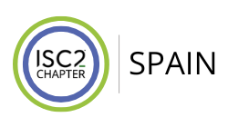

<!--
  README de perfil de la organización GitHub.
  Visible en https://github.com/ISC2-Chapter-Spain
-->

  <picture>
    <source media="(prefers-color-scheme: dark)" srcset="./assets/logo_horizontal_dark.png">
    
  </picture>

# ISC2 Chapter Spain

Comunidad local de profesionales de seguridad de la información y ciberseguridad en España. Capítulo oficial de [ISC2](https://www.isc2.org/), la asociación internacional sin ánimo de lucro de profesionales certificados en ciberseguridad.

**Connect · Educate · Inspire · Secure**

## Misión

Fomentar la excelencia profesional, el intercambio de conocimiento y el crecimiento de la comunidad de ciberseguridad en España. Abrimos la puerta tanto a quien ya trabaja en el sector como a quien está empezando.

> Juntos podemos marcar la diferencia inspirando un mundo digital seguro.

## Qué hacemos

- Impulsar iniciativas de seguridad de la información a nivel nacional
- Formar a la comunidad local frente a amenazas reales
- Promover certificaciones ISC2 (CISSP, CCSP y resto del portfolio) alineadas con el mercado
- Facilitar networking entre profesionales y aspirantes
- Organizar charlas y eventos con expertos
- Colaborar con otras organizaciones en iniciativas de ciberseguridad
- Defender la ética y el desarrollo de la profesión

## Próximo evento

**Jornada de Ciberseguridad ISC2 Spain** — 5 de mayo de 2026  
Presencial · Espacio Cromátika · Madrid · 16:00–21:00

Agenda, ponentes y registro: [isc2chapter-spain.com/eventos/conferencia_2026](https://www.isc2chapter-spain.com/eventos/conferencia_2026)

## Formación

| Certificación | Enfoque |
| --- | --- |
| [CISSP](https://www.isc2chapter-spain.com/formacion/cissp) | Liderazgo, gestión y arquitectura en seguridad de la información |
| [CCSP](https://www.isc2chapter-spain.com/formacion/ccsp) | Seguridad en entornos cloud |

Más sobre el portfolio global de certificaciones: [isc2.org](https://www.isc2.org/)

## Únete

La pertenencia al chapter está abierta a profesionales y aspirantes. No hace falta tener una certificación ISC2 para participar en el chapter (sí para ser miembro de ISC2 a nivel global).

| Recurso | Enlace |
| --- | --- |
| Web del chapter | [isc2chapter-spain.com](https://www.isc2chapter-spain.com/) |
| Únete al chapter | [Registro](https://www.isc2chapter-spain.com/) |
| Newsletter | [Números publicados](https://www.isc2chapter-spain.com/) |
| LinkedIn | [ISC2 Spain Chapter](https://www.linkedin.com/company/isc2chapter-spain) |
| ISC2 global | [isc2.org](https://www.isc2.org/) |
| Directorio de chapters | [isc2.org/chapters](https://www.isc2.org/chapters) |

---

  
    ISC2 Chapter Spain · Capítulo oficial de
    <a href="https://www.isc2.org/">ISC2</a>
    · 160+ chapters en 50+ países
  

